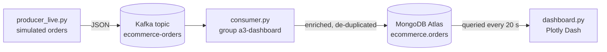
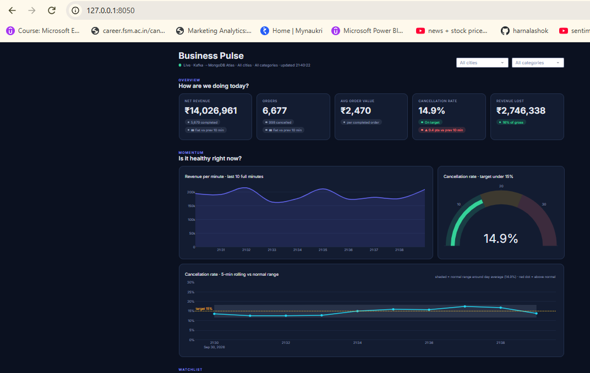
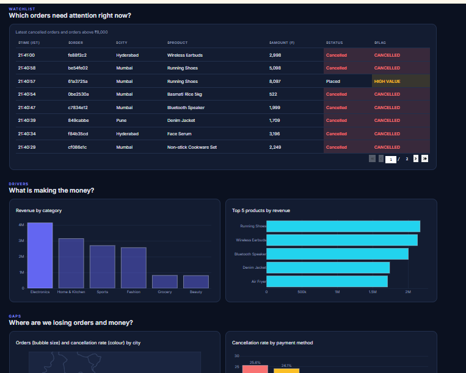
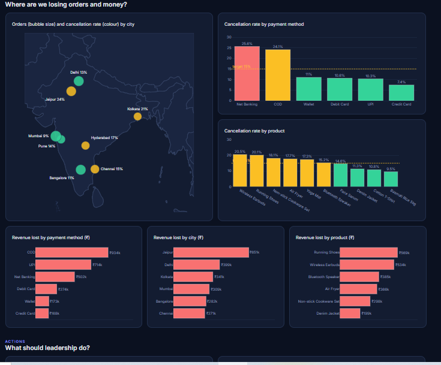
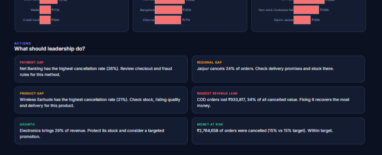

# SDA Assignment 3: Live E-commerce "Business Pulse" Dashboard

**Name:** Unnati Jain | **Roll No:** 065051 | **Course:** Streaming Data Analytics, FORE School of Management

A real-time pipeline that streams e-commerce orders through Kafka into MongoDB Atlas and shows them on a live executive dashboard built with Plotly Dash.

## Architecture



## Files

| File | Purpose |
|---|---|
| `producer.py`, `sample_ecommerce_data.json`, `generate_sample.py`, `docker-compose.yml` | Assignment 2: replays 500 fixed orders to Kafka |
| `producer_live.py` | Assignment 3: endless order generator with built-in business patterns |
| `consumer.py` | Reads from Kafka, enriches, de-duplicates, stores in Atlas |
| `dashboard.py` | Live dashboard (Plotly Dash) |
| `requirements.txt`, `.env.example` | Setup |

## What consumer.py does
1. Adds `ingested_at` (arrival time) for live time-based charts
2. Flags `high_value` orders (over Rs 8,000)
3. Flags `at_risk` orders (cancelled)
4. Skips duplicate `order_id`s using a unique index

## Dashboard
Sections follow the order a CEO/COO reads it: **Overview** (5 KPI cards with trend arrows) → **Momentum** (revenue per minute, cancellation gauge, 5-minute rolling cancellation rate with normal-range band) → **Watchlist** (cancelled and high-value orders) → **Drivers** (revenue by category, top products) → **Gaps** (India map, cancellation rate and revenue lost by payment method, city, product) → **Actions** (auto-written recommendations). City and Category filters apply to everything. Refreshes every 20 seconds.






## Design choices
- Cancelled orders are excluded from revenue.
- `ingested_at` makes "last 10 minutes" true regardless of the order's own timestamp.
- The revenue line shows only completed minutes, so a partial minute never looks like a crash.
- Rate charts are paired with rupee charts: a high rate in a small segment can cost less than a moderate rate in a large one.
- Segments with fewer than 10 orders are hidden.

## How to run
1. Install: `pip install -r requirements.txt`
2. Copy `.env.example` to `.env` and put in your MongoDB Atlas connection string. Allow your IP in Atlas Network Access.
3. Start Kafka: `docker compose up -d`
4. Run each in its own terminal, in this order:
```
   python consumer.py
   python producer_live.py
   python dashboard.py
```
5. Open http://127.0.0.1:8050

## Data note
The data is **simulated**. The generator embeds assumed patterns (regional cancellation differences, cash-on-delivery risk, product effects, and a recurring payment-gateway outage) so the dashboard has realistic gaps to detect. The figures are illustrative, not real-world findings.